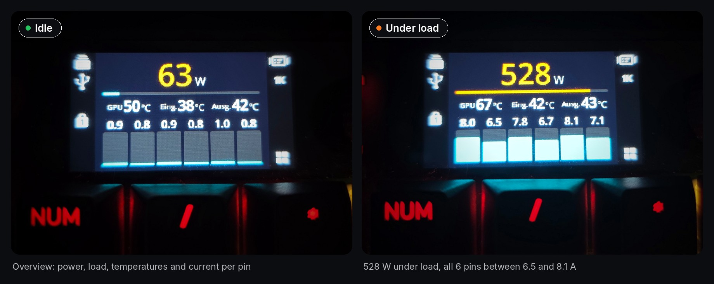
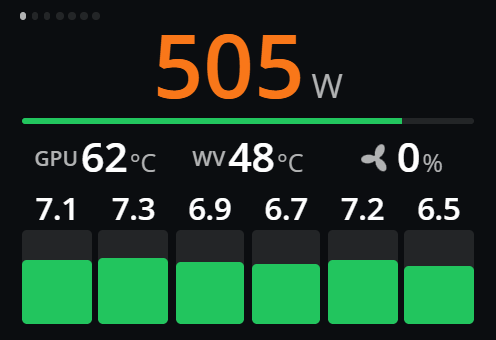
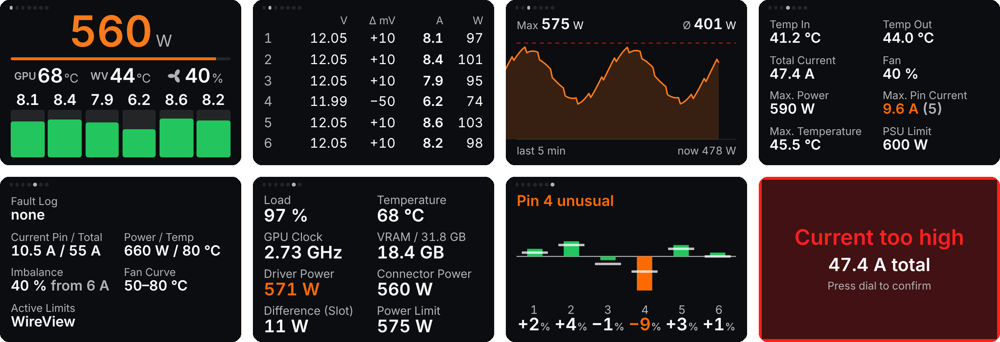
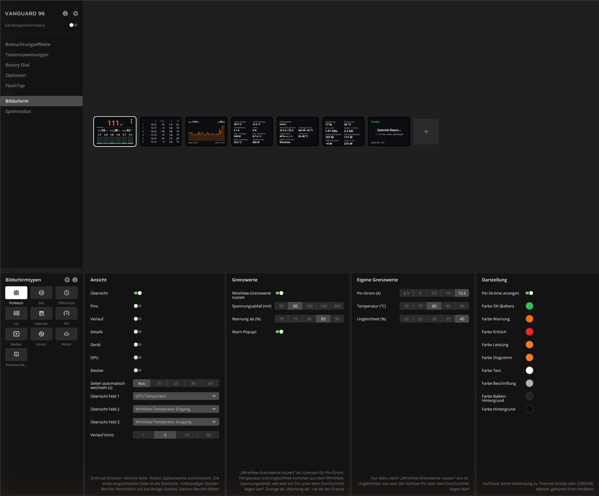
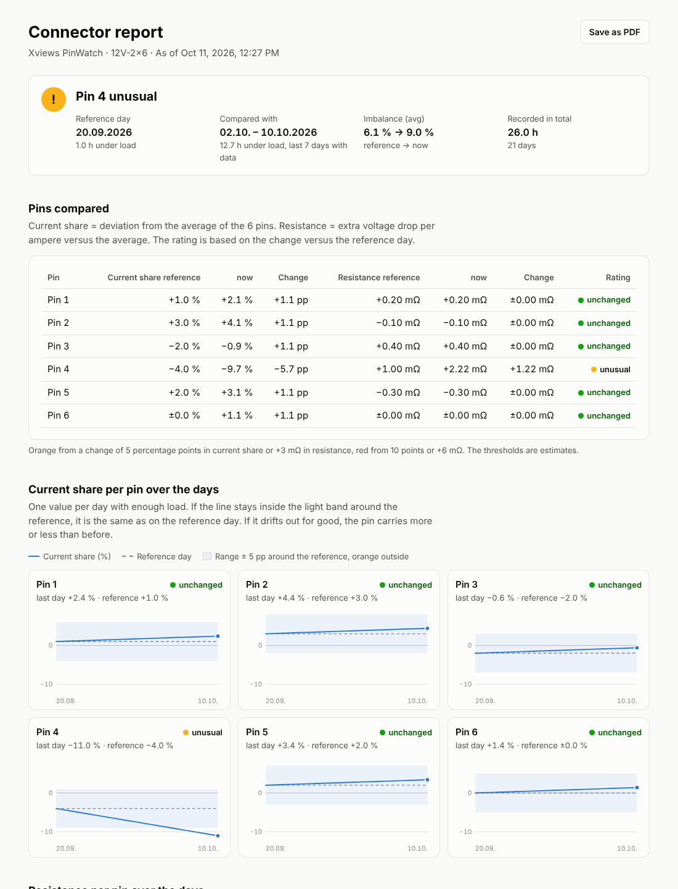
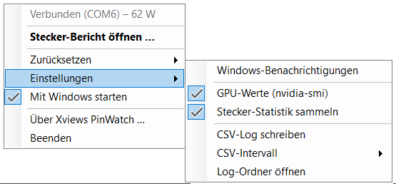

<p align="center">
  
</p>

<h1 align="center">Xviews PinWatch Widget</h1>

<p align="center">
  The <b>Thermal Grizzly WireView Pro II</b>, live on the display of the <b>CORSAIR VANGUARD 96</b>.<br>
  Current of every pin, connector health over weeks and GPU values, right on your keyboard.
</p>

<p align="center">
  <a href="https://github.com/xviews/xviews-pinwatch-widget/releases/latest"></a>
</p>

<p align="center">
  <a href="#features">Features</a> ·
  <a href="#installation">Installation</a> ·
  <a href="#usage">Usage</a> ·
  <a href="#safety-privacy-legal">Safety</a> ·
  <a href="README.md">Deutsch</a>
</p>

---

**Important:** The widget is for **iCUE 5** (version 5.47 or newer). The WireView must also be **connected to the PC
with its USB cable**, the readings only come through it. Without the USB cable the widget shows "WireView not connected".

> **Unofficial project.** Not affiliated with, endorsed by or supported by Thermal Grizzly, CORSAIR or Elgato.
> All product names and trademarks belong to their respective owners. Use at your own risk.



```
WireView Pro II ──USB──► PinWatchBridge.exe ──localhost:8787──► iCUE widget ──► VANGUARD 96 display
```

iCUE widgets run sandboxed and cannot talk to USB devices. The small **PinWatch Bridge** reads the WireView
directly over USB and makes the values available to the widget on your own PC only (`localhost`).
Neither the Thermal Grizzly app nor HWiNFO is needed.

## Features

<p align="center">
  <br>
  <sub>Demo with simulated values: paging through, imbalance with warning popup, confirming with the dial.</sub>
</p>



*All seven pages and a warning popup (test data).*

- **7 pages**, switch by pressing the dial (initially only the overview is on, switch on more pages in iCUE):
  1. **Overview** – total power, load vs. PSU limit, three selectable values (e.g. GPU temperature,
     WireView temperature, fan), current per pin
  2. **Pins** – voltage, deviation from average (mV), current and power for each of the 6 pins
  3. **History** – power curve for the last 1/5/10/30 minutes with maximum, average and PSU limit
  4. **Details** – inlet/outlet temperature, external sensors, total current, fan, peak values
  5. **Device** – fault log, WireView limits, fan curve, active limits
  6. **GPU** – NVIDIA graphics card via `nvidia-smi`: load, temperature, clock, VRAM, driver-reported power compared
     with the power through the connector (the difference mostly comes from the PCIe slot)
  7. **Connector** – health of the 12V-2x6 connector over days and weeks: current share and resistance of each pin
     compared with a reference day, one column per pin
- **Traffic light colors** (green / orange / red, all colors adjustable). A dot appears top right on every page as soon as
  anything is orange or red, red also adds a red frame
- **Warning popups**, confirmed by pressing the dial:
  active WireView fault (current, pin current, power or temperature too high, imbalance), current imbalance between pins, voltage drop on a pin
  (hint for a bad contact), new entry in the WireView fault log, a connector pin clearly different from the reference day ("Check pin 4")
- Uses the **limits stored in the WireView** or your own limits
- Peak values, a 30 minute history and the connector statistics are kept by the bridge, even while the widget is
  not shown
- English and German: the widget follows the iCUE language, the bridge and scripts the Windows language

## Requirements

- Windows 10/11 (64-bit)
- **iCUE 5**, version 5.47 or newer. Widgets on the display of VANGUARD keyboards only work from this version on
- CORSAIR VANGUARD 96 or VANGUARD PRO 96 (wired, iCUE mode)
- Thermal Grizzly WireView Pro II with its **USB cable to the PC**. The cable goes from the WireView to a USB port of
  the PC (e.g. an internal USB 2.0 header or a port on the back of the PC)
- [.NET 10 Desktop Runtime (x64)](https://dotnet.microsoft.com/download/dotnet/10.0) for the bridge.
  `Install.cmd` checks this and opens the download page if needed

## Installation

Download: the ZIP file of the latest version under [Releases](https://github.com/xviews/xviews-pinwatch-widget/releases/latest).

> **Windows warning on first start.** The bridge is not signed with a paid certificate, so Windows may show "Windows
> protected your PC" (SmartScreen). Click **More info** and then **Run anyway**. Easier: before extracting, right-click
> the ZIP file → **Properties** → tick **Unblock** at the bottom → OK. Windows then does not warn for any of the files
> inside.

1. **Close the Thermal Grizzly WireView app** (also from the system tray). Only one program can use the
   WireView at a time.
2. Run **`Install.cmd`**. It copies the bridge to `%LOCALAPPDATA%\Programs\Xviews PinWatch Bridge`, adds it to
   Windows autostart, adds a Start menu entry and starts it. A connector icon appears in the system tray
   (green = connected, grey = not connected).
   If you exited the bridge, start it again from the Start menu: press the Windows key, type "PinWatch", Enter.
3. **Import the widget in iCUE.** At the end the installer asks whether iCUE should import the widget right away
   (Enter = yes). With **Y** it opens the widget file like a double-click and iCUE imports it itself.
   Otherwise double-click **`Xviews-PinWatch-Widget.icuewidget`** or drag it into the import window under
   **VANGUARD 96 → Screen → Screen types → +** (the installer opens its folder).
   Allow access to `localhost:8787`, then add the widget **PinWatch** under **VANGUARD 96 → Screen → +**. Adding it to the screen
   is always done by hand, iCUE stores that in the profile.
4. In iCUE under **Rotary Dial**, enable **Screen widget**. On the VANGUARD 96, **Fn + F12** switches the dial
   between volume and screen widget.

## Usage

| Dial | Action |
|---|---|
| Press | next page, or confirm a warning popup |
| Hold | reset peak values |
| Turn | switch between widgets (handled by iCUE) |

Tip: add the widget several times and switch on only one page in each (e.g. one with just "GPU"). Turning the
dial then flips through the pages.

## Settings in iCUE
<details>
<summary>Show all settings</summary>



| Group | Setting | Meaning |
|---|---|---|
| View | Overview … Connector | Which pages this widget shows. Initially only the overview is on. The dial pages through the switched-on pages, the first one is the start page. With only one page there are no page dots; with all off the overview is shown |
| | Auto page change (s) | Switch to the next page every few seconds |
| | Overview field 1–3 | The three values below the power: voltage, WireView temperature (highest, in, out, ext. sensor 1/2, each marked WV/In/Out/Ext1/Ext2), WireView fan, total current, GPU temperature, GPU load, GPU power, GPU clock or difference (slot). Default: GPU temperature, WireView temperature, fan. GPU values show the voltage without an NVIDIA GPU |
| | History (min) | Time span of the history page |
| Limits | Use WireView limits | On: pin current, temperature and imbalance limits are read from the WireView |
| | Voltage drop (mV) | How far a pin may be below the average voltage before a warning |
| | Warning from (%) | Share of a limit at which values turn orange (red from the limit on) |
| | Warning popups | Popups on/off |
| Own limits | Pin current / temperature / imbalance | Only used when "Use WireView limits" is off |
| Appearance | Show pin currents | Pin currents above the overview bars on/off |
| | Colors | OK (bars), warning, critical, power (big number), chart (history curve), text, labels (units and names), bar background and background |

**Imbalance** = how far the strongest pin is above the average of all 6 pins. Imbalance and voltage drop are
only evaluated above a minimum load (WireView setting, typically 6 A total).

</details>

## Connector health over time

A contact that gets worse shows up as a pin that carries less (or more) current than it used to, with more voltage
dropping across it. For every second in which the graphics card draws at least 10 A, the bridge collects per pin:

- **Current share** – deviation from the average of the 6 pins in %
- **Resistance** – voltage drop versus the average divided by the pin current (mΩ, independent of load)

The values are stored per day (`%LOCALAPPDATA%\Xviews PinWatch Bridge\health.json`, up to 400 days). The first day
with at least 15 minutes under load becomes the **reference**. The Connector page compares the last 7 days with it:

| Change versus reference | Orange | Red (+ popup, once per day) |
|---|---|---|
| Current share of a pin | from 5 percentage points | from 10 percentage points |
| Resistance of a pin | from +3 mΩ | from +6 mΩ |

How to read the page:

- **Header:** rating naming the affected pins: "Connector OK" (green), "Pin 4 unusual" (orange, keep an eye on it),
  "Check pin 4" (red, switch the PC off and look at the connector). Several pins: "Pins 2 + 4 unusual".
- **Columns:** one column per pin, right above its number. It shows how much current the pin carried over the last
  7 days compared with the average of the 6 pins: up = more, down = less. The light line shows where the pin was on
  the reference day. If column and line meet, nothing has changed.
- **Numbers below the columns:** the same deviation in % (−9 % = carries 9 % less than average).
- **Color:** green = unchanged, orange/red = clear change versus the reference (current share or resistance). The
  color rates the change, not the deviation itself.

The reference day, imbalance and the history over the days are shown in the bridge's connector report (see below).

These thresholds are starting values and not yet proven on real connectors. After re-plugging or replacing the cable,
choose **Reset → Connector reference …** in the bridge menu.

### Connector report

**Open connector report …** in the bridge menu (or a double-click on the icon) opens a page in your browser (`http://localhost:8787/report`) with
everything the display is too small for: rating, a table of all pins (current share and resistance, reference → now),
the history of each pin over all days, imbalance per day and a table of all days. The page is generated by the bridge
on your own PC and loads nothing from the internet. The bridge only builds it when you open it, it costs nothing in
the background. **Save as PDF** at the top right saves the report as a PDF (choose "Save as PDF" or "Microsoft Print
to PDF" in the print dialog).



## Tray icon (right-click)
<details>
<summary>Show menu and Windows notifications</summary>



- Status at the top, e.g. "Connected (COM6) – 558 W"
- **Open connector report …** – detailed report in the browser (see above), also by double-clicking the icon
- **Reset** → Peak values, Connector reference …
- **Settings** →
  - **Windows notifications** on/off (off at first), see below
  - **GPU values (nvidia-smi)** on/off – off stops nvidia-smi, the GPU page shows "GPU values off"
  - **Collect connector statistics** on/off – off collects nothing and shows no connector popup, the history is kept
  - **Write CSV log** on/off (off at first), **CSV interval** 1 s / 5 s / 60 s, **Open log folder**
- **Start with Windows** on/off
- About Xviews PinWatch (version, link to the project)
- Exit

The bridge remembers these switches in `%LOCALAPPDATA%\Xviews PinWatch Bridge\settings.json`.

**Windows notifications**

The bridge also reports the same cases as the widget popups as Windows notifications, even while the display shows
something else: active WireView fault (current, pin current, power or temperature too high, imbalance), imbalance
between pins, voltage drop on a pin, new entry in the fault log and "Check pin 4" for the connector. It uses the same
limits as the widget in iCUE (the widget passes them to the bridge). Each notification appears once when the state
lasts 2 seconds, and again only after it was gone for 30 seconds and 5 minutes have passed. Clicking it opens the
connector report. Off at first, switch it on under **Settings → Windows notifications**. Windows hides them while "Do not disturb"
is on.

</details>

## CSV log
<details>
<summary>CSV log details</summary>

The bridge writes one file per day, `%LOCALAPPDATA%\Xviews PinWatch Bridge\logs\pinwatch-YYYY-MM-DD.csv`, with time,
total power, total current, voltage, voltage/current/power of each pin, temperatures, fan, fault status and (if
available) GPU load, temperature, power and clock. Separator and decimal mark follow the Windows language, so Excel
opens the file directly, even while it is still being written.

Size is about 25 MB per day at 1 s, 5 MB at 5 s and 0.4 MB at a 60 s interval. Old files are not deleted
automatically.

</details>

## Troubleshooting
<details>
<summary>Show common problems</summary>

| Widget shows | Cause |
|---|---|
| "Bridge not running" | The bridge is not running. Start **Xviews PinWatch Bridge** from the Start menu. |
| "WireView not connected" | WireView not found: check the USB cable at the WireView and at the PC. Or the COM port is in use (WireView app still open?). |
| Display stays black after an update | Remove the widget in iCUE and import it again. |

Bridge options: `--com COM6` (fixed port instead of auto-detect), `--port 8787`, `--demo` (test data without a device),
`--no-gpu` (turn off the GPU query via nvidia-smi).

| GPU page shows | Cause |
|---|---|
| "No NVIDIA GPU" | No NVIDIA driver installed or `nvidia-smi.exe` not found. On AMD/Intel, switch the page off in iCUE under "View". |

</details>

## Uninstall
<details>
<summary>How to uninstall</summary>

Run **`Uninstall.cmd`** (removes the bridge, the autostart and the Start menu entry).
Delete the PinWatch screens in iCUE first. The script then asks separately:

- whether to remove the widget files imported by iCUE (`%APPDATA%\Corsair\CUE5\html_widgets\com\xviews`). iCUE
  must be closed for this, the script offers to close it and starts it again afterwards.
  Enter = yes.
- whether to delete settings, connector statistics and CSV logs (`%LOCALAPPDATA%\Xviews PinWatch Bridge`).
  Enter = no, the data is kept.

</details>

## How it works
<details>
<summary>Technical details</summary>

The WireView Pro II appears as a virtual COM port (STM32, VID 0483 / PID 5740). The bridge uses **read-only**
commands only (sensor values, device info, configuration). It never changes the configuration, firmware or
display of the WireView.

The bridge offers a local HTTP API on `localhost:8787`:
`/readings` (live values incl. GPU), `/history?seconds=300` (history), `/health?days=30` (connector health),
`/health/reset-reference`, `/reset-peaks`, `/report` (connector report as a web page).

</details>

## Safety, privacy, legal

- **Not a safety device.** The widget shows readings and warnings but does not replace the protection of the
  WireView, the graphics card or the power supply. There is no guarantee that warnings appear in time or at all.
  The thresholds of the connector health page are estimates. If you suspect a melting connector, switch the PC off
  and check the connector.
- **Privacy.** All data stays on your PC. The bridge is only reachable via `localhost` and never connects to the
  internet. It only stores settings, connector statistics and (if enabled) CSV logs in
  `%LOCALAPPDATA%\Xviews PinWatch Bridge`.
- **Unofficial.** Not affiliated with Thermal Grizzly, ElmorLabs, CORSAIR, Elgato or NVIDIA. Trademarks belong to
  their owners and are only used descriptively.
- **Device protocol.** Independent implementation, worked out from the official sample code
  [WireViewPro2-Python](https://github.com/ElmorLabs-ThermalGrizzly/WireViewPro2-Python) (MIT License) and, for the
  device configuration, the [WireViewDeviceLib](https://github.com/ElmorLabs-ThermalGrizzly/WireViewDeviceLib). No
  code copied. See [THIRD-PARTY-NOTICES.md](THIRD-PARTY-NOTICES.md).

## License

Free, MIT license, see [LICENSE.txt](LICENSE.txt). No warranty, use at your own risk.
