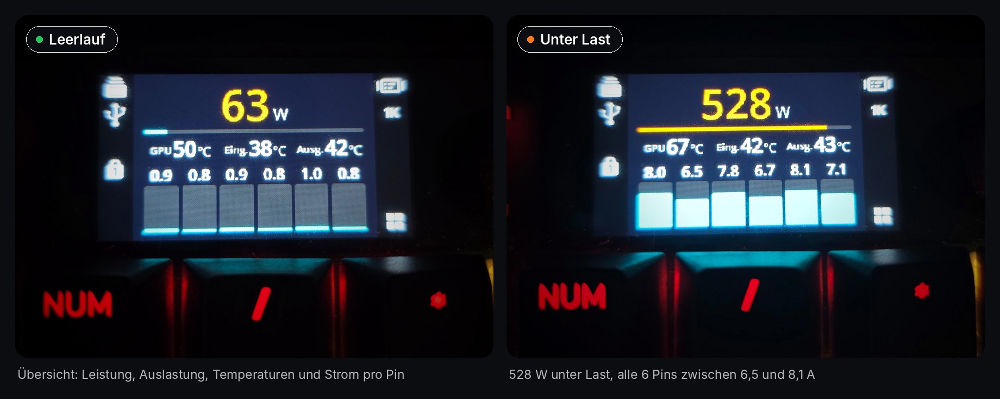
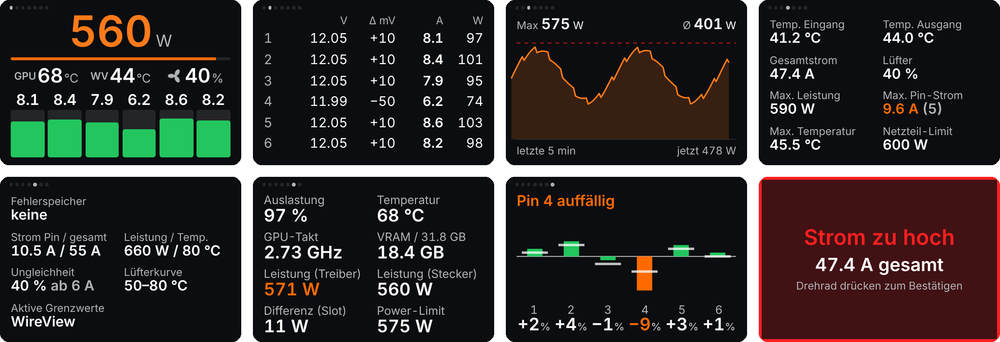
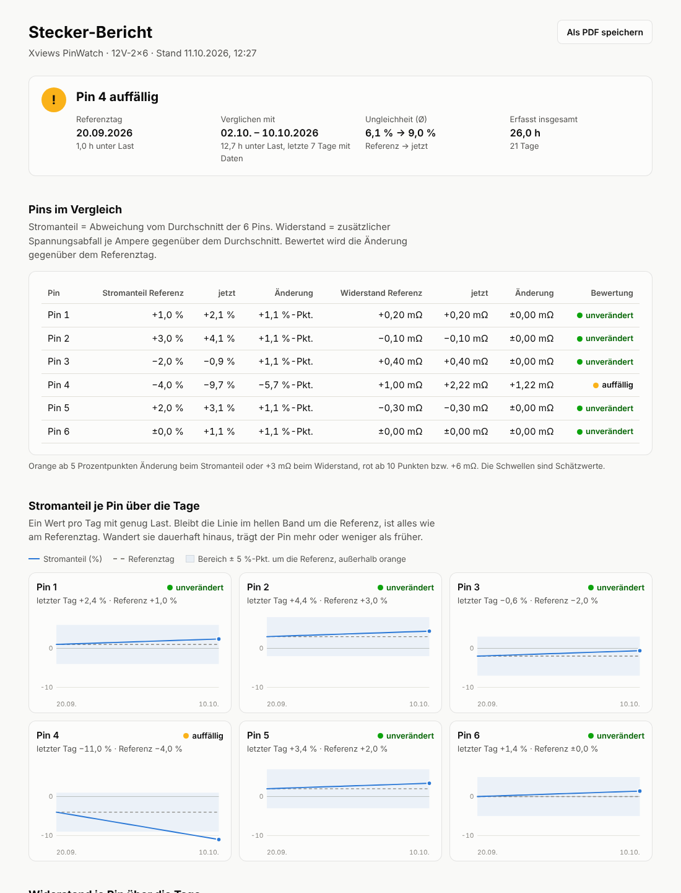

# Xviews PinWatch Widget

Das **Thermal Grizzly WireView Pro II** live auf dem Display der **CORSAIR VANGUARD 96**.

[](https://github.com/xviews/xviews-pinwatch-widget/releases/latest)

ZIP-Datei der neuesten Version für Windows 10/11 (64 Bit). Weitere Hinweise unter [Installation](#installation).

**Wichtig:** Das Widget ist für **iCUE 5** (ab Version 5.47). Das WireView muss zusätzlich **per USB-Kabel mit dem PC
verbunden** sein, nur darüber kommen die Messwerte. Ohne USB-Kabel zeigt das Widget „WireView nicht verbunden“.

> **Inoffizielles Projekt.** Keine Verbindung zu Thermal Grizzly, CORSAIR oder Elgato, nicht von ihnen
> unterstützt. Alle Produktnamen und Marken gehören ihren jeweiligen Inhabern. Nutzung auf eigene Gefahr.

English version: [README.en.md](README.en.md)



```
WireView Pro II ──USB──► PinWatchBridge.exe ──localhost:8787──► iCUE-Widget ──► Display der VANGUARD 96
```

iCUE-Widgets laufen abgeschottet und können keine USB-Geräte ansprechen. Die kleine **PinWatch Bridge** liest
das WireView direkt über USB aus und stellt die Werte nur auf dem eigenen PC bereit (`localhost`).
Weder die Thermal-Grizzly-App noch HWiNFO werden benötigt.

## Funktionen



*Alle sieben Seiten und ein Warn-Popup (Testdaten).*

- **7 Seiten**, Wechsel per Druck aufs Drehrad (anfangs ist nur die Übersicht an, weitere Seiten in iCUE einschalten):
  1. **Übersicht** – Gesamtleistung, Auslastung gegenüber dem Netzteil-Limit, drei frei wählbare Werte (z. B. GPU-Temperatur,
     WireView-Temperatur, Lüfter), Strom pro Pin
  2. **Pins** – Spannung, Abweichung vom Durchschnitt (mV), Strom und Leistung aller 6 Pins
  3. **Verlauf** – Leistungskurve der letzten 1/5/10/30 Minuten mit Maximum, Durchschnitt und Netzteil-Limit
  4. **Details** – Temperatur Eingang/Ausgang, externe Fühler, Gesamtstrom, Lüfter, Spitzenwerte
  5. **Gerät** – Fehlerspeicher, Grenzwerte des WireView, Lüfterkurve, aktive Grenzen
  6. **GPU** – NVIDIA-Grafikkarte über `nvidia-smi`: Auslastung, Temperatur, Takt, VRAM, Leistung laut Treiber im
     Vergleich zur Leistung am Stecker (die Differenz kommt im Wesentlichen aus dem PCIe-Slot)
  7. **Stecker** – Zustand des 12V-2x6-Steckers über Tage und Wochen: Stromanteil und Widerstand jedes Pins im
     Vergleich zu einem Referenztag, eine Säule pro Pin
- **Ampelfarben** (grün / orange / rot, alle Farben einstellbar). Oben rechts erscheint auf jeder Seite ein Punkt, sobald
  irgendwo etwas orange oder rot ist, bei Rot zusätzlich ein roter Rahmen
- **Warn-Popups**, Bestätigung per Druck aufs Drehrad:
  aktiver WireView-Fehler (Strom, Pin-Strom, Leistung oder Temperatur zu hoch, Ungleichheit), Ungleichheit zwischen den Pins, Spannungsabfall an einem Pin
  (Hinweis auf schlechten Kontakt), neuer Eintrag im Fehlerspeicher des WireView, ein Pin des Steckers deutlich anders als
  am Referenztag („Pin 4 prüfen“)
- Nutzt die **im WireView gespeicherten Grenzwerte** oder eigene Grenzwerte
- Spitzenwerte, 30 Minuten Verlauf und die Stecker-Statistik führt die Bridge, auch wenn das Widget gerade nicht
  angezeigt wird
- Deutsch und Englisch: das Widget folgt der Sprache von iCUE, Bridge und Skripte der Windows-Sprache

## Voraussetzungen

- Windows 10/11 (64 Bit)
- **iCUE 5** ab Version 5.47. Erst ab dieser Version laufen Widgets auf dem Display der VANGUARD-Tastaturen
- CORSAIR VANGUARD 96 oder VANGUARD PRO 96 (kabelgebunden, iCUE-Modus)
- Thermal Grizzly WireView Pro II mit **USB-Kabel zum PC**. Das Kabel steckt am WireView und an einem
  USB-Anschluss des PCs (z. B. ein interner USB-2.0-Header oder ein Anschluss hinten am PC)
- [.NET 10 Desktop Runtime (x64)](https://dotnet.microsoft.com/download/dotnet/10.0) für die Bridge.
  `Install.cmd` prüft das und öffnet bei Bedarf die Download-Seite

## Installation

Download: die ZIP-Datei der neuesten Version unter [Releases](https://github.com/xviews/xviews-pinwatch-widget/releases/latest).

> **Windows-Warnung beim ersten Start.** Die Bridge ist nicht mit einem kostenpflichtigen Zertifikat signiert. Windows
> zeigt deshalb eventuell „Der Computer wurde durch Windows geschützt“ (SmartScreen). Dann auf **Weitere Informationen**
> und **Trotzdem ausführen** klicken. Einfacher: vor dem Entpacken Rechtsklick auf die ZIP-Datei → **Eigenschaften** →
> unten **Zulassen** anhaken → OK. Dann warnt Windows bei keiner der enthaltenen Dateien mehr.

1. **Die WireView-App von Thermal Grizzly schließen** (auch im Infobereich). Nur ein Programm kann das WireView
   gleichzeitig nutzen.
2. **`Install.cmd`** ausführen. Es kopiert die Bridge nach `%LOCALAPPDATA%\Programs\Xviews PinWatch Bridge`,
   trägt sie in den Windows-Autostart ein, legt einen Eintrag im Startmenü an und startet sie. Im Infobereich
   erscheint ein Stecker-Symbol (grün = verbunden, grau = keine Verbindung).
   Wurde die Bridge beendet, startet man sie über das Startmenü wieder: Windows-Taste, „PinWatch“ tippen, Enter.
3. **Widget in iCUE importieren.** Am Ende fragt der Installer, ob iCUE das Widget gleich importieren soll
   (Enter = ja). Mit **J** öffnet er die Widget-Datei wie ein Doppelklick und iCUE importiert sie selbst.
   Sonst: **`Xviews-PinWatch-Widget.icuewidget`** doppelt anklicken oder in iCUE unter **VANGUARD 96 → Bildschirm →
   Bildschirmtypen → +** in das Import-Fenster ziehen (der Installer öffnet den Ordner).
   Den Zugriff auf `localhost:8787` erlauben, dann unter **VANGUARD 96 → Bildschirm → +** das Widget **PinWatch** hinzufügen.
   Das Hinzufügen zum Bildschirm macht man immer selbst, das speichert iCUE im Profil.
4. In iCUE unter **Rotary Dial** das **Bildschirm-Widget** aktivieren. Mit **Fn + F12** schaltet die VANGUARD 96
   das Drehrad zwischen Lautstärke und Bildschirm-Widget um.

## Bedienung

| Drehrad | Wirkung |
|---|---|
| Drücken | nächste Seite oder Warn-Popup bestätigen |
| Halten | Spitzenwerte zurücksetzen |
| Drehen | zwischen den Widgets wechseln (macht iCUE) |

Tipp: Das Widget mehrfach hinzufügen und bei jedem nur eine Seite einschalten (z. B. eines nur „GPU“). Dann
blättert man per Drehen durch die Seiten.

## Einstellungen in iCUE


| Gruppe | Einstellung | Bedeutung |
|---|---|---|
| Ansicht | Übersicht … Stecker | Welche Seiten dieses Widget zeigt. Anfangs ist nur die Übersicht an. Das Drehrad blättert durch die eingeschalteten, die erste ist die Startseite. Bei nur einer Seite gibt es keine Seitenpunkte, sind alle aus, erscheint die Übersicht |
| | Seiten automatisch wechseln (s) | Alle paar Sekunden zur nächsten Seite |
| | Übersicht Feld 1–3 | Die drei Werte unter der Leistung: Spannung, WireView-Temperatur (höchste, Eingang, Ausgang, ext. Fühler 1/2, jeweils mit Kennzeichnung WV/Eing./Ausg./Ext1/Ext2), WireView-Lüfter, Gesamtstrom, GPU-Temperatur, GPU-Auslastung, GPU-Leistung, GPU-Takt oder Differenz (Slot). Standard: GPU-Temperatur, WireView-Temperatur, Lüfter. GPU-Werte ohne NVIDIA-GPU zeigen die Spannung |
| | Verlauf (min) | Zeitraum der Verlaufsseite |
| Grenzwerte | WireView-Grenzwerte nutzen | An: Grenzen für Pin-Strom, Temperatur und Ungleichheit kommen aus dem WireView |
| | Spannungsabfall (mV) | Wie weit ein Pin unter der Durchschnittsspannung liegen darf |
| | Warnung ab (%) | Ab welchem Anteil einer Grenze die Anzeige orange wird (ab der Grenze rot) |
| | Warn-Popups | Popups an/aus |
| Eigene Grenzwerte | Pin-Strom / Temperatur / Ungleichheit | Nur aktiv, wenn „WireView-Grenzwerte nutzen“ aus ist |
| Darstellung | Pin-Ströme anzeigen | Pin-Ströme über den Balken der Übersicht ein/aus |
| | Farben | OK (Balken), Warnung, Kritisch, Leistung (große Zahl), Diagramm (Verlaufskurve), Text, Beschriftung (Einheiten und Bezeichnungen), Balken-Hintergrund und Hintergrund |

**Ungleichheit** = wie weit der am stärksten belastete Pin über dem Durchschnitt aller 6 Pins liegt.
Ungleichheit und Spannungsabfall werden erst ab einer Mindestlast bewertet (WireView-Einstellung, meist 6 A gesamt).

## Steckerzustand über die Zeit

Ein schlechter werdender Kontakt zeigt sich daran, dass ein Pin dauerhaft weniger (oder mehr) Strom trägt als früher
und mehr Spannung an ihm abfällt. Die Bridge sammelt dafür jede Sekunde, in der die Grafikkarte mindestens 10 A zieht, pro Pin:

- **Stromanteil** – Abweichung vom Durchschnitt der 6 Pins in %
- **Widerstand** – Spannungsabfall gegenüber dem Durchschnitt geteilt durch den Pin-Strom (mΩ, lastunabhängig)

Die Werte werden pro Tag gespeichert (`%LOCALAPPDATA%\Xviews PinWatch Bridge\health.json`, bis zu 400 Tage).
Der erste Tag mit mindestens 15 Minuten unter Last wird zur **Referenz**. Die Seite „Stecker“ vergleicht die letzten 7 Tage
mit dieser Referenz:

| Änderung gegenüber Referenz | Orange | Rot (+ Popup, einmal pro Tag) |
|---|---|---|
| Stromanteil eines Pins | ab 5 Prozentpunkten | ab 10 Prozentpunkten |
| Widerstand eines Pins | ab +3 mΩ | ab +6 mΩ |

So liest man die Seite:

- **Kopfzeile:** Bewertung mit den betroffenen Pins: „Stecker OK“ (grün), „Pin 4 auffällig“ (orange, beobachten),
  „Pin 4 prüfen“ (rot, PC ausschalten und Stecker ansehen). Mehrere Pins: „Pins 2 + 4 auffällig“.
- **Säulen:** eine Säule pro Pin, direkt über seiner Nummer. Sie zeigt, wie viel Strom der Pin in den letzten 7 Tagen
  im Vergleich zum Durchschnitt der 6 Pins trägt: nach oben mehr, nach unten weniger. Der helle Strich zeigt, wo der
  Pin am Referenztag lag. Liegen Säule und Strich zusammen, hat sich nichts verändert.
- **Zahlen unter den Säulen:** dieselbe Abweichung in % (−9 % = trägt 9 % weniger als der Schnitt).
- **Farbe:** grün = unverändert, orange/rot = deutliche Veränderung gegenüber der Referenz (Stromanteil oder
  Widerstand). Die Farbe bewertet die Veränderung, nicht die Abweichung selbst.

Referenztag, Ungleichheit und den Verlauf über die Tage zeigt der Stecker-Bericht der Bridge (siehe unten).

Diese Schwellen sind Startwerte und noch nicht an echten Steckern erprobt. Nach dem Neu-Einstecken oder Tauschen des
Kabels im Menü der Bridge **Zurücksetzen → Stecker-Referenz …** wählen.

### Stecker-Bericht

Im Menü der Bridge öffnet **Stecker-Bericht öffnen …** (oder ein Doppelklick auf das Symbol) eine Seite im Browser
(`http://localhost:8787/report`) mit allem, wofür das Display zu klein ist: Bewertung, Tabelle aller Pins (Stromanteil und Widerstand, Referenz → jetzt),
Verlauf jedes Pins über alle Tage, Ungleichheit pro Tag und eine Tabelle aller Tage. Die Seite wird von der Bridge
auf dem eigenen PC erzeugt und lädt nichts aus dem Internet. Die Bridge erzeugt sie nur beim Öffnen, im
Hintergrund kostet sie nichts. Oben rechts speichert **Als PDF speichern** den Bericht als PDF (im Druckdialog
„Als PDF speichern“ bzw. „Microsoft Print to PDF“ wählen).



## Symbol im Infobereich (Rechtsklick)


- Oben der Status, z. B. „Verbunden (COM6) – 558 W“
- **Stecker-Bericht öffnen …** – ausführlicher Bericht im Browser (siehe oben), auch per Doppelklick auf das Symbol
- **Zurücksetzen** → Spitzenwerte, Stecker-Referenz …
- **Einstellungen** →
  - **Windows-Benachrichtigungen** an/aus (anfangs aus), siehe unten
  - **GPU-Werte (nvidia-smi)** an/aus – aus beendet nvidia-smi, die GPU-Seite zeigt „GPU-Werte aus“
  - **Stecker-Statistik sammeln** an/aus – aus sammelt nichts mehr und zeigt kein Stecker-Popup, der Verlauf bleibt gespeichert
  - **CSV-Log schreiben** an/aus (anfangs aus), **CSV-Intervall** 1 s / 5 s / 60 s, **Log-Ordner öffnen**
- **Mit Windows starten** an/aus
- Über Xviews PinWatch (Version, Link zum Projekt)
- Beenden

Die Schalter merkt sich die Bridge in `%LOCALAPPDATA%\Xviews PinWatch Bridge\settings.json`.

### Windows-Benachrichtigungen

Die Bridge meldet dieselben Fälle wie die Popups des Widgets zusätzlich als Windows-Benachrichtigung, auch wenn das
Display gerade etwas anderes zeigt: aktiver WireView-Fehler (Strom, Pin-Strom, Leistung oder Temperatur zu hoch,
Ungleichheit), Ungleichheit zwischen den Pins, Spannungsabfall an einem Pin, neuer Eintrag im Fehlerspeicher und
„Pin 4 prüfen“ beim Stecker. Sie nutzt dieselben Grenzwerte wie das Widget in iCUE (das Widget teilt sie der Bridge
mit). Jede Meldung kommt einmal, wenn der Zustand 2 Sekunden anhält, und frühestens wieder, wenn er 30 Sekunden weg war
und 5 Minuten vergangen sind. Ein Klick auf die Meldung öffnet den Stecker-Bericht. Anfangs aus, einschalten unter
**Einstellungen → Windows-Benachrichtigungen**. Ist in Windows „Nicht stören“ aktiv, zeigt Windows sie nicht an.

## CSV-Log

Die Bridge schreibt pro Tag eine Datei `%LOCALAPPDATA%\Xviews PinWatch Bridge\logs\pinwatch-JJJJ-MM-TT.csv` mit Zeit,
Gesamtleistung, Gesamtstrom, Spannung, Spannung/Strom/Leistung jedes Pins, Temperaturen, Lüfter, Fehlerstatus und
(falls vorhanden) GPU-Auslastung, -Temperatur, -Leistung und -Takt. Trennzeichen und Dezimalzeichen richten sich
nach der Windows-Sprache, Excel öffnet die Datei direkt per Doppelklick, auch während weitergeschrieben wird.

Größe etwa 25 MB pro Tag bei 1 s, 5 MB bei 5 s und 0,4 MB bei 60 s Intervall. Alte Dateien werden nicht automatisch
gelöscht.

## Fehlersuche

| Widget zeigt | Ursache |
|---|---|
| „Bridge läuft nicht“ | Die Bridge läuft nicht. Im Startmenü **Xviews PinWatch Bridge** starten. |
| „WireView nicht verbunden“ | WireView nicht gefunden: USB-Kabel am WireView und am PC prüfen. Oder COM-Port belegt (WireView-App noch offen?). |
| Display bleibt nach einem Update schwarz | Widget in iCUE entfernen und neu importieren. |

Optionen der Bridge: `--com COM6` (fester Port statt automatischer Erkennung), `--port 8787`, `--demo` (Testdaten ohne Gerät),
`--no-gpu` (GPU-Abfrage über nvidia-smi abschalten).

| GPU-Seite zeigt | Ursache |
|---|---|
| „Keine NVIDIA-GPU“ | Kein NVIDIA-Treiber installiert oder `nvidia-smi.exe` nicht gefunden. Bei AMD/Intel die Seite in iCUE unter „Ansicht“ ausschalten. |

## Deinstallation

**`Uninstall.cmd`** ausführen (entfernt Bridge, Autostart- und Startmenü-Eintrag).
Vorher in iCUE die PinWatch-Bildschirme löschen. Das Skript fragt danach einzeln:

- ob die von iCUE importierten Widget-Dateien (`%APPDATA%\Corsair\CUE5\html_widgets\com\xviews`) entfernt werden
  sollen. Dafür muss iCUE beendet sein, das Skript bietet an, es zu schließen, und startet es danach wieder.
  Enter = ja.
- ob Einstellungen, Stecker-Statistik und CSV-Logs (`%LOCALAPPDATA%\Xviews PinWatch Bridge`) gelöscht werden sollen.
  Enter = nein, die Daten bleiben erhalten.

## Funktionsweise

Das WireView Pro II meldet sich als virtueller COM-Port (STM32, VID 0483 / PID 5740). Die Bridge nutzt
**ausschließlich lesende** Befehle (Sensorwerte, Geräteinfos, Konfiguration). Konfiguration, Firmware und Display
des WireView werden nie verändert.

Lokale HTTP-Schnittstelle auf `localhost:8787`: `/readings` (Live-Werte inkl. GPU), `/history?seconds=300` (Verlauf),
`/health?days=30` (Steckerzustand), `/health/reset-reference`, `/reset-peaks`, `/report` (Stecker-Bericht als Webseite).

## Sicherheit, Datenschutz, Rechtliches

- **Kein Sicherheitsgerät.** Das Widget zeigt Messwerte und Warnungen an, ersetzt aber nicht die Schutzfunktionen
  des WireView, der Grafikkarte oder des Netzteils. Es gibt keine Garantie, dass Warnungen rechtzeitig oder überhaupt
  erscheinen. Die Grenzwerte der Stecker-Auswertung sind Schätzwerte. Bei Verdacht auf einen schmorenden Stecker
  den PC ausschalten und den Stecker prüfen.
- **Datenschutz.** Alle Daten bleiben auf dem eigenen PC. Die Bridge ist nur über `localhost` erreichbar und verbindet sich
  nicht mit dem Internet. Gespeichert werden nur Einstellungen, Stecker-Statistik und (falls eingeschaltet) CSV-Logs
  in `%LOCALAPPDATA%\Xviews PinWatch Bridge`.
- **Inoffiziell.** Keine Verbindung zu Thermal Grizzly, ElmorLabs, CORSAIR, Elgato oder NVIDIA. Marken gehören ihren
  Inhabern und werden nur beschreibend verwendet.
- **Geräteprotokoll.** Eigene Umsetzung, nachvollzogen anhand des offiziellen Beispielcodes
  [WireViewPro2-Python](https://github.com/ElmorLabs-ThermalGrizzly/WireViewPro2-Python) (MIT-Lizenz) und, für die
  Gerätekonfiguration, der [WireViewDeviceLib](https://github.com/ElmorLabs-ThermalGrizzly/WireViewDeviceLib). Kein Code
  übernommen. Details in [THIRD-PARTY-NOTICES.md](THIRD-PARTY-NOTICES.md).

## Lizenz

Kostenlos, MIT-Lizenz, siehe [LICENSE.txt](LICENSE.txt). Ohne Gewährleistung, Nutzung auf eigene Gefahr.
